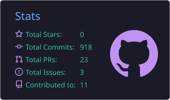

<h3 align="center">LLM systems that are grounded, measured and shipped</h3>

  
  
  
  
  

  

---

### Introduction

I'm an AI Engineer focused on **RAG, LLM applications and AI agents**. I care about the parts that decide whether an LLM system works in practice: what gets retrieved, which decisions stay in code instead of the model, hard limits on agent loops, and measuring results against simple baselines instead of trusting a demo.

I've shipped a RAG-based relevancy evaluator to production, built a hand-written ReAct agent that runs 24/7 and grades its own calls in a live forward test, and run LLM automations in live business operations.

Open to **AI Engineer / LLM Engineer roles**, remote or Pakistan-based, full-time or contract.

## 🧠 What I Work On

- **RAG:** chunking and embeddings, vector search (ChromaDB, Pinecone), two-stage retrieve-then-score pipelines, relevancy evaluation
- **AI agents:** LangGraph state graphs, tool-calling loops, human-in-the-loop pauses, guardrails, tool/time/round caps
- **LLM engineering:** structured outputs with Pydantic, prompt-injection defences, rate-limit fallbacks, streaming (SSE), tracing with Langfuse
- **Evaluation:** golden-set trajectory tests, forward testing, calibration reports against naive baselines

## ⚡ Currently

- 📈 **Running** FinSight's live forward test: 1,400+ graded calls so far, full results in January
- 🔬 **Going deeper** into agent evaluation and retrieval quality
- 💼 **Open to** AI Engineer roles

---

## 🏗️ Featured Work

### 📊 [FinSight](https://github.com/abdulah-x/FinSight) — ReAct Market-Bias Agent
Hand-written ReAct agent on LangGraph (no prebuilt agents) that gives a Bullish / Bearish / Neutral bias for BTC, ETH and gold. Guardrail model, parallel evidence tool, `interrupt()` for missing input and hard caps on every loop. The LLM never decides the score: it is computed in code, and every call is graded in a live forward test against simple baselines. Runs 24/7 at $0 on Groq and Oracle Cloud.
`LangGraph` · `Groq` · `FastAPI` · `PostgreSQL` · `Docker` · `Langfuse`

### 🤖 RAG-Based Relevancy Evaluator *(Paramount Intelligence)*
LLM pipeline evaluating content relevance with retrieval-augmented generation. Shipped to production.
`Python` · `LLMs` · `Vector Search` · `RAG`

### 🎯 [JobRadar](https://github.com/abdulah-x/JobRadar) — RAG Job Matching
Two-stage pipeline: embeddings + ChromaDB filter jobs against resume chunks at no LLM cost, then Gemini scores the survivors with the top-3 retrieved chunks and returns structured output (score, matching / missing skills, seniority). Groq fallback on rate limits.
`RAG` · `ChromaDB` · `Gemini` · `Pydantic` · `Docker`

### ⚙️ [AI Automation Workflows](https://github.com/abdulah-x/n8n) — n8n
Voice AI receptionist backend (Vapi, 9 workflows), a daily AI news digest with Pinecone dedup, and a WhatsApp chatbot running in production at Paramount Intelligence.
`n8n` · `Gemini` · `Pinecone` · `Webhooks`

### 🦅 Hawk-Ear — Audio-Video Surveillance Platform
Dockerized platform with **8 microservices** running real-time audio + video AI analysis. Final Year Project, ~90% solo contribution.
`Python` · `FastAPI` · `Docker` · `Microservices`

---

## 🛠️ Stack

  
  
  
  
  
  
  
  
  
  
  
  
  
  
  
  
  
  
  
  
  
  
  
  
  
  
  
  
  
  
  
  
  
  
  
  
  
  
  
  
  
  

---

### GitHub

  

  

  

  

---

## 🤝 Let's Build Something

Hiring, collaborating, or just curious about the work? I respond fast.

  
  

<i>Models get the spotlight. Pipelines do the work.</i>

